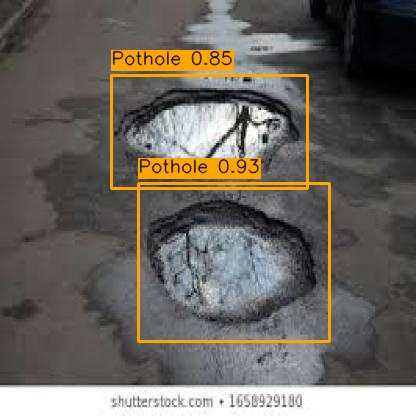
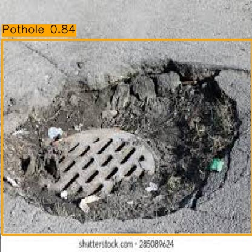
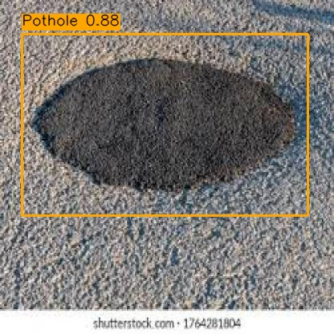

# PotholeGuard-AI

PotholeGuard-AI is a pothole detection project built with computer vision and deep learning. The repository includes a fine-tuned YOLOv8 model for stronger real-world inference, a custom YOLOv3-Tiny pipeline for learning and comparison, a Streamlit web app, evaluation artifacts, trained weights, and sample detections.

## Overview

This project focuses on pothole detection without retraining at deployment time. The latest YOLOv8 inference flow uses post-processing cleanup to reduce duplicate boxes, suppress weak detections, and keep the output cleaner for demos and deployment.

Core capabilities:

- YOLOv8 pothole detection with optimized no-retrain inference settings
- Custom YOLOv3-Tiny training and inference pipeline
- Streamlit web application for interactive testing
- Validation plots, confusion matrix, and saved sample detections
- Grad-CAM support for explainability on the YOLOv3 path

## Models in the Repository

### YOLOv8

- Base model: `yolov8n.pt`
- Fine-tuned weights: `yolov8_pothole_best.pt`
- Training script: `train_yolov8.py`
- Optimized inference script: `inference_yolov8.py`

The latest no-retrain YOLOv8 deployment settings used in this project are:

- `conf = 0.44`
- `post-filter confidence >= 0.45`
- `iou = 0.55`
- `agnostic_nms = True`
- `max_det (raw) = 8`
- `max displayed detections = 5`
- `min box area = 800`
- `aspect ratio range = 0.3 to 3.0`
- `augment = True`

### YOLOv3-Tiny

- Model definition: `model.py`
- Training script: `train.py`
- Inference pipeline: `inference.py`
- Evaluation pipeline: `evaluate.py`
- Explainability: `gradcam.py`

## Latest YOLOv8 Validation Metrics

These values were generated from the saved model `yolov8_pothole_best.pt` and written to `evaluation_metrics/metrics_summary.txt`.

| Metric | Value |
| --- | ---: |
| Precision | 0.730839 |
| Recall | 0.699805 |
| mAP50 | 0.732630 |
| mAP50-95 | 0.357677 |

Validation artifacts are saved in [`evaluation_metrics/`](evaluation_metrics), including:

- `BoxF1_curve.png`
- `BoxPR_curve.png`
- `BoxP_curve.png`
- `BoxR_curve.png`
- `confusion_matrix.png`
- `confusion_matrix_normalized.png`
- `metrics_summary.txt`
- `metrics_summary.json`

## Saved Cleaned Detection Images

These three images were generated with the cleaned YOLOv8 inference flow and are included in the repository.

### sample_detection_1.jpg



### sample_detection_2.jpg



### sample_detection_3.jpg



## Project Structure

```text
PotholeGuard-AI/
|-- app.py
|-- config.py
|-- dataset.py
|-- evaluate.py
|-- gradcam.py
|-- inference.py
|-- inference_yolov8.py
|-- model.py
|-- train.py
|-- train_yolov8.py
|-- utils.py
|-- requirements.txt
|-- pothole_dataset.yaml
|-- yolov8_pothole_best.pt
|-- yolo_rdd_1.pth
|-- yolo_rdd_3.pth
|-- dataset_yolo/
|-- dataset-pothole-main/
|-- evaluation_metrics/
|-- results/
`-- runs/
```

## Installation

### 1. Clone the repository

```bash
git clone https://github.com/Yug-doshi/PotholeGuard-AI.git
cd PotholeGuard-AI
```

### 2. Install dependencies

```bash
pip install -r requirements.txt
```

## Requirements

Main dependencies:

- Python 3.10+
- PyTorch
- Torchvision
- OpenCV
- Streamlit
- Matplotlib
- Pillow
- Ultralytics

## Run the Project

### Launch the Streamlit app

```bash
streamlit run app.py
```

### Run YOLOv8 inference on a single image

```bash
python inference_yolov8.py path/to/image.jpg
```

### Run YOLOv3 inference

```bash
python inference.py path/to/image.jpg
```

### Validate the YOLOv8 model

```bash
python train_yolov8.py --validate-only
```

### Run the YOLOv3 evaluation pipeline

```bash
python evaluate.py
```

## Web App Highlights

The Streamlit interface supports:

- YOLOv8 and YOLOv3 model selection
- Image upload and pothole detection
- Detection summaries and confidence reporting
- Grad-CAM visualization for the YOLOv3 path
- Project explanation content for presentation or interview use

YOLOv8 is the recommended inference option in the app.

## Datasets and Weights Included

This repository currently includes:

- The YOLO-format dataset in `dataset_yolo/`
- The original pothole dataset in `dataset-pothole-main/`
- Trained YOLOv3 weight files
- Fine-tuned YOLOv8 weight files
- Training and validation outputs under `runs/`
- Fresh validation outputs under `evaluation_metrics/`

## Notes

- No retraining was required for the latest deployment cleanup.
- The latest cleaned detections are already saved in `evaluation_metrics/`.
- The evaluation metrics listed above come from the current saved YOLOv8 model in this repository.

